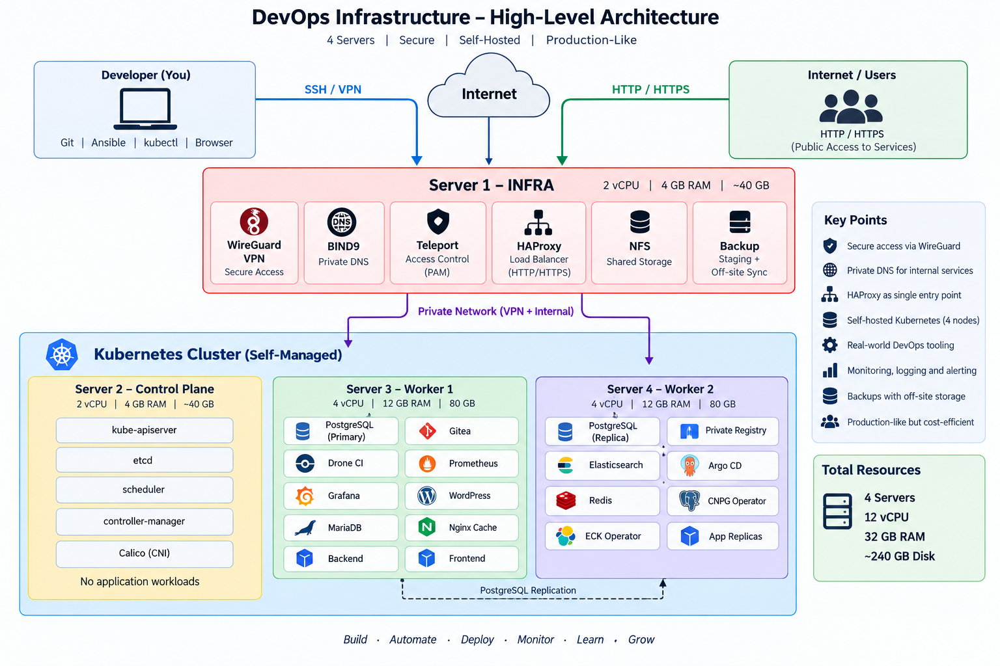

# Production DevOps Platform

A production-like, self-hosted DevOps/SRE platform designed and implemented from an SRS.

The project demonstrates the complete lifecycle of a modern infrastructure platform: secure networking, Kubernetes orchestration, GitOps, CI/CD, stateful services, observability, centralized logging, backup and disaster recovery.

## Architecture

The platform consists of four Linux servers connected through a private WireGuard network.

| Node | Role | Private IP |
|---|---|---|
| `infra-01` | VPN, DNS, HAProxy, NFS and infrastructure services | `10.50.0.1` |
| `k8s-cp-01` | Kubernetes control plane | `10.50.0.10` |
| `k8s-worker-01` | Kubernetes worker | `10.50.0.11` |
| `k8s-worker-02` | Kubernetes worker | `10.50.0.12` |

Kubernetes version: `v1.35.4`

Container runtime: `containerd 2.2.3`

Network plugin: `Calico`

### High-Level Architecture



## Core Technologies

### Infrastructure
- Ubuntu Server
- Ansible
- WireGuard
- BIND9
- HAProxy
- UFW
- NFS

### Kubernetes
- Kubernetes
- containerd
- Calico
- NetworkPolicy
- NFS CSI
- Local Path Provisioner

### GitOps and CI/CD
- Gitea
- Drone CI
- Argo CD
- Private Container Registry

### Data Services
- CloudNativePG
- PostgreSQL
- Redis HA

### Monitoring
- Prometheus
- Grafana
- Alertmanager
- Node Exporter
- Blackbox Exporter

### Logging
- Elastic Cloud on Kubernetes
- Elasticsearch
- Logstash
- Kibana
- Filebeat

### Backup and Recovery
- Velero
- Kopia File System Backup
- MinIO
- PostgreSQL logical backup
- Gitea native backup
- etcd snapshots

## GitOps Architecture

Argo CD continuously reconciles the Kubernetes environment against the Git repository.

The platform uses an App-of-Apps architecture:

```text
Git Repository
      |
      v
platform-root
      |
      +-- PostgreSQL
      +-- Redis
      +-- Gitea
      +-- Drone
      +-- Registry
      +-- Monitoring
      +-- Logging
      +-- Platform Demo
      +-- Additional platform services
```

All deployed Argo CD applications were validated as `Synced` and `Healthy`.

## CI/CD Flow

The platform demonstrates a complete software delivery pipeline:

```text
Developer
   |
   v
Gitea
   |
   v
Drone CI
   |
   v
Build Container Image
   |
   v
Private Registry
   |
   v
GitOps Repository
   |
   v
Argo CD
   |
   v
Kubernetes
```

A demo frontend/backend application was deployed to validate the complete pipeline.

## PostgreSQL

PostgreSQL is operated by CloudNativePG.

Current architecture:

- 2 PostgreSQL instances
- Primary/replica architecture
- Automatic failover capability
- Persistent local storage
- Kubernetes NetworkPolicy protection

Database connectivity and primary/replica operation were verified.

Unauthorized PostgreSQL access from an unrelated Kubernetes Pod was tested and successfully blocked by NetworkPolicy.

## Redis

Redis is deployed as a replicated high-availability service.

Current architecture:

- 3 Redis nodes
- 1 master
- 2 replicas
- Sentinel-based failover
- Persistent local storage

Replication status was validated successfully.

## Monitoring

The monitoring stack is based on `kube-prometheus-stack`.

It includes:

- Prometheus
- Grafana
- Alertmanager
- kube-state-metrics
- Node Exporter
- Blackbox Exporter

Monitoring covers Kubernetes nodes, workloads and platform services.

## Centralized Logging

The logging pipeline is:

```text
Container stdout/stderr
        |
        v
Filebeat
        |
        v
Logstash
        |
        v
Elasticsearch
        |
        v
Kibana
```

The stack uses Elasticsearch `9.5.5`.

An end-to-end logging test was performed by generating a unique message inside a Kubernetes Pod and verifying that the same event reached Elasticsearch through Filebeat and Logstash.

## Security

The environment includes multiple security layers.

### Network Security

- WireGuard private network between infrastructure nodes
- UFW enabled on all servers
- Default inbound firewall policy: deny
- Administrative SSH access through WireGuard
- Kubernetes NetworkPolicies

### SSH Access Control

SSH hardening is applied to all platform nodes:

- Root SSH login disabled
- Password authentication disabled
- Keyboard-interactive authentication disabled
- Public-key authentication enabled
- Empty passwords disabled
- Maximum authentication attempts limited to 3
- Administrative SSH access restricted to the `devops` account
- PAM enabled

### Database Isolation

PostgreSQL ingress is restricted with Kubernetes NetworkPolicy.

Only explicitly authorized workloads such as Gitea, Drone, CloudNativePG and approved platform applications can reach PostgreSQL.

A deny test from an unauthorized namespace successfully timed out, confirming policy enforcement.

## Backup and Disaster Recovery

The project includes multiple backup layers.

### Velero

Velero `v1.18.4` is deployed with node-agent and Kopia File System Backup.

Backup object storage is hosted outside the Kubernetes cluster using an S3-compatible MinIO endpoint.

Daily schedule:

```text
02:00 Europe/Berlin
```

Retention:

```text
7 days
```

### Restore Test

A complete recovery test was performed:

1. A Kubernetes namespace and Pod were created.
2. Test data was written into a volume.
3. Velero backed up Kubernetes resources and volume data.
4. The namespace was deleted.
5. The backup was restored.
6. The restored file was compared with the original value.

Result:

```text
RESTORE TEST PASSED
```

This validated both Kubernetes resource recovery and volume-data recovery.

### PostgreSQL Backup

A logical cluster-level PostgreSQL backup is stored separately using `pg_dumpall`.

The resulting compressed backup was validated with `gzip -t`.

### Gitea Backup

Gitea repositories, configuration and application data are backed up using the native:

```text
gitea dump
```

The resulting archive was validated successfully with `unzip -t`.

### etcd Backup

A Kubernetes control-plane etcd snapshot is created using:

```text
etcdctl snapshot save
```

The snapshot is copied to external storage and retained separately from the Kubernetes cluster.

## Storage

The platform uses multiple storage classes based on workload requirements.

| StorageClass | Purpose |
|---|---|
| `local-pg` | PostgreSQL persistent storage |
| `local-redis` | Redis persistent storage |
| `local-logging` | Elasticsearch and Logstash |
| `nfs-rwx` | Shared ReadWriteMany storage |

Persistent volumes use retention-oriented configuration for stateful workloads.

## Validation

The final platform validation confirmed:

- Kubernetes control plane healthy
- Both worker nodes Ready
- PostgreSQL cluster healthy
- Redis nodes healthy
- Gitea operational
- Drone CI operational
- Private registry operational
- Argo CD applications Synced and Healthy
- Prometheus operational
- Grafana operational
- Alertmanager operational
- Elasticsearch green
- Kibana green
- Filebeat healthy
- Logstash healthy
- Velero backup storage available
- Scheduled backup enabled
- Real backup and restore test passed
- NetworkPolicy deny test passed
- SSH hardening verified on all servers
- UFW active with default-deny inbound policy

## Project Status

### Infrastructure

- [x] Infrastructure architecture
- [x] WireGuard private network
- [x] Private DNS
- [x] HAProxy
- [x] NFS
- [x] Firewall
- [x] SSH/PAM access controls

### Kubernetes

- [x] Multi-node Kubernetes cluster
- [x] Calico networking
- [x] Persistent storage
- [x] NetworkPolicies

### Platform Services

- [x] Gitea
- [x] Drone CI
- [x] Private Container Registry
- [x] Argo CD
- [x] PostgreSQL
- [x] Redis

### Observability

- [x] Prometheus
- [x] Grafana
- [x] Alertmanager
- [x] Centralized ELK logging

### Backup and Recovery

- [x] Backup strategy
- [x] Off-cluster backup storage
- [x] Daily backup schedule
- [x] Retention policy
- [x] PostgreSQL logical backup
- [x] Gitea backup
- [x] etcd snapshot
- [x] Restore and data-integrity testing

## Repository Structure

```text
production-devops-platform/
├── arch/       # Architecture diagrams
├── cicd/       # CI/CD configuration
├── docs/       # Project documentation
├── infra/      # Infrastructure configuration
├── k8s/        # Kubernetes and GitOps manifests
└── README.md
```

## Result

The final result is a functional production-like DevOps platform covering infrastructure automation, secure networking, Kubernetes, GitOps, CI/CD, stateful workloads, observability, centralized logging, access control, backup and disaster recovery.
